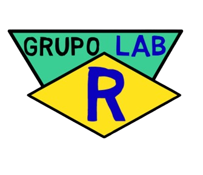

<p align="center">
  
</p>

<p align="center">
  <a href="https://grupolabr.com/" target="_blank">
    
  </a>
</p>

# LabR Group Website

This repository holds the files of the LabR Group's institutional website, published through **GitHub Pages**, GitHub's free service that turns the files in a repository into a publicly accessible website.

The site is **static**: it is made of ready-to-serve HTML pages (HTML is the language that structures the content of a web page). There is no server, no database and no build step. What is in the repository is exactly what visitors see.

---

## Structure

```
/
├── index.html              ← home page
├── About_us.html
├── Team.html
├── Projects.html
├── LabRI_Packed.html
├── LabRI_chatbot.html
├── Book.html
├── Presentations.html
├── Blog.html
├── FAQ.html
├── Contact.html
├── labr-style.css          ← look and feel of the whole site
├── labr-nav.js             ← navigation menu
├── labr-icons.js           ← icons
├── imagens/                ← photos, logos and figures
├── CNAME                   ← custom domain
├── robots.txt              ← rules for search engines
└── sitemap.xml             ← site map for search engines
```

---

## Pages

Table 1. HTML pages of the website and what each one presents to visitors.

| File | Content |
|---|---|
| `index.html` | Home page. GitHub Pages opens this file when someone visits the site address, so its name must not change. |
| `About_us.html` | Presentation of the group: who we are, what we do and our focus. |
| `Team.html` | Group members. |
| `Projects.html` | The group's research and development projects. |
| `LabRI_Packed.html` | Page of the LabRI tool. |
| `LabRI_chatbot.html` | Chatbot (automated conversational assistant) about LabRI. |
| `Book.html` | The group's book or publication. |
| `Presentations.html` | Presentations and talks. |
| `Blog.html` | Articles and news. |
| `FAQ.html` | Frequently Asked Questions. |
| `Contact.html` | Ways to contact the group. |

---

## Supporting files

These files are not pages themselves, but every page depends on them.

Table 2. Files shared by all pages and what happens if they are missing.

| File | Purpose | If missing |
|---|---|---|
| `labr-style.css` | CSS stylesheet (the file that defines colors, fonts, spacing and layout). It centralizes the look: a change here updates every page at once. | Pages display as plain, unformatted text. |
| `labr-nav.js` | JavaScript script (the language that gives behavior to a page) that builds the navigation menu. The menu is written once and reused on every page. | No page will have a menu. |
| `labr-icons.js` | Script that provides the icons used across the site. | Icons disappear or appear broken. |
| `imagens/` | Folder with the photos, logos and figures referenced by the pages. | Images show up as empty boxes. |

---

## Configuration and search engines

Table 3. Files that configure publication and indexing by search engines such as Google.

| File | Purpose | Note |
|---|---|---|
| `CNAME` | Tells GitHub Pages the site's custom domain, instead of the default `username.github.io` address. | Must be named exactly `CNAME`, **with no extension**. If it becomes `CNAME.txt`, the custom domain stops working. |
| `robots.txt` | Tells search engine crawlers what they may or may not index. | Not required for the site to work, but good practice. |
| `sitemap.xml` | Lists every page of the site so search engines find them faster. | Update it whenever a page is created, renamed or removed. |

---

## Maintenance

**Preview locally:** 1st download the repository (green **Code** button → **Download ZIP**); 2nd unzip it; 3rd open `index.html` in a browser.

**Add a new page:** 1st copy an existing page as a template, so it inherits the style, menu and icons; 2nd change its content; 3rd add the link to `labr-nav.js`; 4th add its address to `sitemap.xml`; 5th upload it to the repository.

**Publish a change:** just upload the modified file to the repository. GitHub Pages updates the site within a few minutes.

**Cautions:**
- Do not rename `index.html`, `CNAME`, `robots.txt` or `sitemap.xml`: GitHub Pages and search engines look for these exact names.
- The server is case-sensitive: `Team.html` and `team.html` are different files. Links must use the exact name.
- When downloading individual files through the browser, check that `.txt` has not been appended to the file name.
